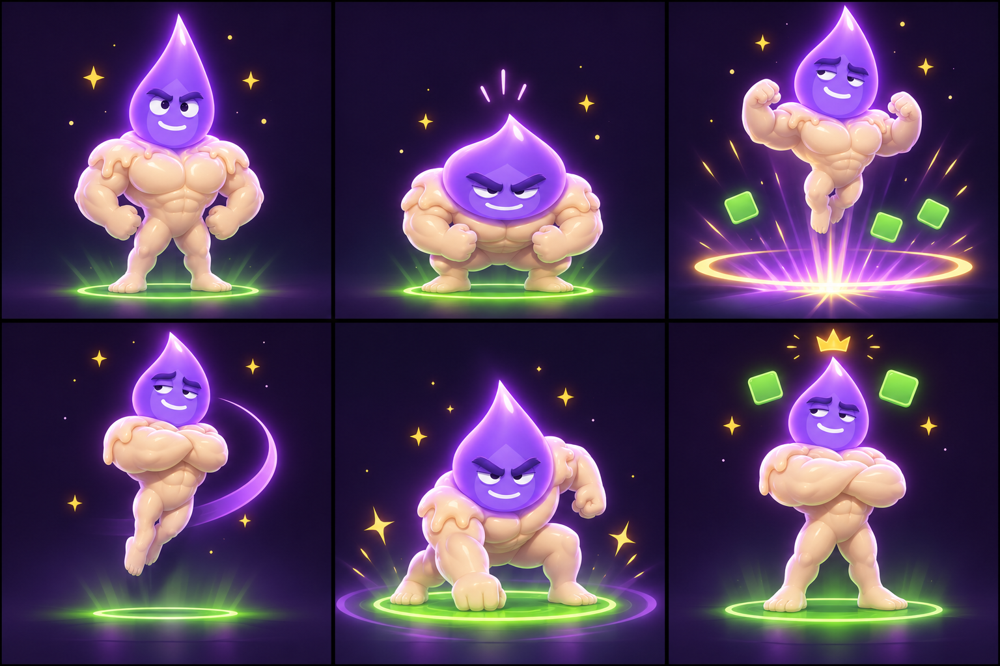

# Wick 3.8 — Signature Victory Moment

> Superseded for implementation by `CLAUDE_3.8_PERSONALITY_POLISH.md`.
> The newer brief reflects the final product decision: Wick remains green at
> the end of a solve, uses the head-only gameplay character, and does not use
> a full-body hero pose. Keep this document only as earlier motion exploration.

## Product intent

Solving should feel like the player finally surprised Wick, followed immediately by Wick reclaiming his composure. The sequence is powerful, funny, and unmistakably his—not a generic confetti celebration.

The emotional sentence is:

> **Wait—you got it. Fine. Of course you did.**

This is a 2.8-second transition into the existing solved result. It must never delay the player from tapping onward: any tap after the initial hit completes the animation immediately and reveals the result state.

## Signature sequence: “Called It”

| Time | Beat | Pose and expression | Stage response |
|---:|---|---|---|
| 0.00–0.12s | **Hit stop** | Wick freezes. Eyes widen by roughly 12%; pupils lock forward. Brows lift only slightly. Flame tip snaps upright. | Background brightness falls briefly; answer tile emits one tight solved-green pulse. Strong success haptic lands immediately. |
| 0.12–0.48s | **Compression** | Body/flame compresses vertically to ~82% and widens to ~108%. Brows draw inward. Mouth becomes a short determined line. | Low violet ring gathers beneath him. Rising sound is short and tactile, not magical choir music. |
| 0.48–0.90s | **Ignition** | Wick launches to ~1.16× resting height. Flame stretches and trails behind by 1–2 frames. | One violet-and-gold shock ring expands. Three square semantic tiles lift and rotate gently. Medium haptic at launch. |
| 0.90–1.42s | **Signature turn** | One controlled quarter-turn—not a full chaotic spin. Arms cross during the turn. Eyes slide sideways before the head finishes rotating. Smirk begins returning. | A single clean purple arc follows the flame tip. Audio resolves into Wick’s three-note motif. |
| 1.42–1.78s | **Hero landing** | Wick lands low, chest forward, one fist planted or weight grounded. Eyes narrow confidently. | Solved-green seal blooms beneath him; four gold sparks hit cardinal directions. Strong but brief landing haptic. No screen shake over 3 px. |
| 1.78–2.80s | **Button pose** | Wick rises and folds his arms. Original half-lidded eyes and crooked smirk return. One eyebrow gives a tiny final lift. | A small crown-shaped gold flame flickers above his tip for 0.45s, then breaks into three sparks. Result UI settles around him rather than replacing him. |

## Character rules

- Wick’s face never becomes a broad happy grin. Satisfaction is expressed through the eyes, eyebrow lift, and compact crooked smirk.
- The surprise beat lasts less than half a second. He never looks frightened by a correct answer.
- Motion has weight: compress before launch, hang briefly at apex, land before returning to pose.
- The flame tip follows the body with slight delay. It is the main source of animation appeal.
- Avoid constant squash, jelly wobble, balloon bounce, frantic spinning, or a confetti storm.
- Gameplay Wick remains the existing renderable flame character. The muscular storyboard is pose language and marketing-level visualization, not a requirement to add a full wax body to gameplay.

## Result choreography

The result information should appear in three steps:

1. **Answer** appears on hit stop.
2. **Guess count / time** appears on hero landing.
3. **Primary next action** fades in during the button pose.

The map, replay, sharing, leaderboard, and secondary actions wait until the final pose. Do not make every button animate independently.

## Audio direction

Create one compact Wick motif rather than a generic victory jingle:

- **Hit:** warm wooden/candle tap with a clean high transient.
- **Rise:** 350–400ms reversed shimmer pitched upward.
- **Motif:** three notes, low–high–middle, ending unresolved enough to feel smug rather than triumphant.
- **Land:** soft bass impact plus a tiny glassy spark.

Total audio should finish by ~1.9s. Never loop it.

## Haptics

- Correct answer: success haptic immediately.
- Launch: light/medium impact.
- Landing: medium impact.
- No haptic on every spark or UI reveal.

## Performance tiers

### Standard solve — always

Use the complete “Called It” sequence above. This becomes Wick’s signature.

### Legendary solve — rare and earned

Trigger only for a first guess, a comeback after at least five non-improving guesses followed by a huge leap, or a race won in the final two seconds.

Differences:

- Hit stop lasts 80ms longer.
- The environment briefly cycles through the seven heat colors behind Wick during ignition.
- Crown flame becomes violet-gold and holds for 0.8s.
- Wick glances at the camera at the end as if the player genuinely impressed him.
- One tiny label may read **LEGENDARY SOLVE** below the answer. No rarity loot language or fake reward chest.

Cap the legendary presentation at once per session so it remains surprising.

## Reduced Motion

Keep the emotional sequence without translation or rotation:

1. Eyes widen and flame brightens.
2. Solved-green ring fades in.
3. Face crossfades into the final smirk.
4. Crown spark appears and dissolves.

Duration: 1.1s. No shake, launch, spin, falling particles, or parallax.

## Cross-platform acceptance criteria

- Web and iOS use the same six beats and emotional timing within 100ms.
- Animation never blocks input after the first 120ms.
- It runs at 60fps on supported devices and creates no persistent particle nodes.
- Sound-off mode remains visually complete.
- Reduced Motion produces no positional movement.
- The answer is readable within 250ms of solving.
- The final face is Wick’s canonical half-lidded smirk, not generic celebration eyes.
- Existing result actions and analytics still fire exactly once.

## Explicitly out of scope for 3.8

- A newly rigged full muscular body in gameplay
- Physics-driven wax drips
- Unlockable victory animations
- Currency or reward chest presentation
- Voice acting
- More than one legendary variation

## Claude Code handoff

Implement the smallest cross-platform motion system that satisfies this brief using the existing Wick renderer, face controls, confetti/spark primitives, sound router, haptic router, and solved-state flow. Reuse current primitives before adding new asset dependencies. Treat the storyboard as animation direction, not literal anatomy.

